# Tài Liệu Đặc Tả Schema Bộ Dữ Liệu Dự Đoán Nhân Viên Nghỉ Việc (Employee Attrition Prediction)

Tài liệu này tổng hợp và đặc tả chi tiết cấu trúc (schema), kiểu dữ liệu, ràng buộc khóa, ý nghĩa nghiệp vụ và mối quan hệ giữa các bảng dữ liệu được phân tích trong notebook [`check_data.ipynb`](file:///D:/Cybersoft__Course/MLOps_01/buoi9/check_data.ipynb).

---

## 1. Tổng Quan Bộ Dữ Liệu (Dataset Overview)

Bộ dữ liệu phục vụ bài toán **Dự đoán rủi ro nghỉ việc của nhân viên trong vòng 90 ngày tới (`left_within_90_days`)**. Hệ thống ghi nhận thông tin nhân sự toàn diện từ hồ sơ nhân viên, kết quả khảo sát gắn kết, lịch sử nghỉ phép, đánh giá năng lực, hoạt động công việc hàng tuần cho đến nhãn nghỉ việc tại các mốc thời gian snapshot.

### Bảng tóm tắt các tập dữ liệu:

| STT | Tập tin (`File Name`) | Vai trò (Role) | Số dòng (Rows) | Số cột (Cols) | Khóa chính / Khóa ngoại |
|:---:|:---|:---|:---:|:---:|:---|
| 1 | [`employees.csv`](file:///D:/Cybersoft__Course/MLOps_01/buoi9/data/employees.csv) | Dimension / Master Table | 15,000 | 13 | **PK:** `employee_id` |
| 2 | [`attrition_labels.csv`](file:///D:/Cybersoft__Course/MLOps_01/buoi9/data/attrition_labels.csv) | Target / Label Table | 128,540 | 7 | **PK:** (`employee_id`, `snapshot_date`) **FK:** `employee_id` |
| 3 | [`work_activity.csv`](file:///D:/Cybersoft__Course/MLOps_01/buoi9/data/work_activity.csv) | Weekly Activity Log | 1,525,283 | 9 | **PK:** (`employee_id`, `week_start`) **FK:** `employee_id` |
| 4 | [`performance_reviews.csv`](file:///D:/Cybersoft__Course/MLOps_01/buoi9/data/performance_reviews.csv) | Review Log | 115,083 | 7 | **PK:** (`employee_id`, `review_date`) **FK:** `employee_id` |
| 5 | [`engagement_surveys.csv`](file:///D:/Cybersoft__Course/MLOps_01/buoi9/data/engagement_surveys.csv) | Survey Log | 101,613 | 7 | **PK:** (`employee_id`, `survey_date`) **FK:** `employee_id` |
| 6 | [`leave_logs.csv`](file:///D:/Cybersoft__Course/MLOps_01/buoi9/data/leave_logs.csv) | Leave Event Log | 87,318 | 6 | **FK:** `employee_id` |
| 7 | [`data_dictionary.csv`](file:///D:/Cybersoft__Course/MLOps_01/buoi9/data/data_dictionary.csv) | Metadata / Data Dict | 11 | 3 | Tra cứu định nghĩa các trường đặc thù |

---

## 2. Sơ Đồ Quan Hệ Thực Thể (Entity Relationship Diagram - ERD)

Mối quan hệ giữa các bảng được liên kết chủ đạo thông qua khóa ngoại `employee_id`:

```mermaid
erDiagram
    EMPLOYEES ||--o{ ATTRITION_LABELS : "có các mốc snapshot nhãn"
    EMPLOYEES ||--o{ WORK_ACTIVITY : "ghi nhận hoạt động tuần"
    EMPLOYEES ||--o{ PERFORMANCE_REVIEWS : "nhận đánh giá định kỳ"
    EMPLOYEES ||--o{ ENGAGEMENT_SURVEYS : "tham gia khảo sát định kỳ"
    EMPLOYEES ||--o{ LEAVE_LOGS : "đăng ký nghỉ phép"

    EMPLOYEES {
        string employee_id PK "Mã định danh nhân viên"
        string department "Phòng ban"
        string role "Chức danh / Vị trí"
        int job_level "Cấp bậc chuyên môn (1-5)"
        string location "Địa điểm làm việc"
        string employment_type "Hình thức làm việc (Full-time/Part-time/Contract)"
        string hire_date "Ngày gia nhập công ty"
        string manager_id "Mã người quản lý trực tiếp"
        int salary_band_min_usd "Lương tối thiểu theo bậc"
        int salary_band_max_usd "Lương tối đa theo bậc"
        int monthly_salary_usd "Mức lương tháng thực tế (USD)"
        int promotion_count "Số lần được thăng chức"
        string last_promotion_date "Ngày thăng chức gần nhất"
    }

    ATTRITION_LABELS {
        string employee_id PK, FK "Mã nhân viên"
        date snapshot_date PK "Ngày snapshot tính nhãn"
        string department "Phòng ban tại thời điểm snapshot"
        int job_level "Cấp bậc tại thời điểm snapshot"
        int left_within_90_days "Target: 1 nếu rời cty trong 90 ngày, 0 nếu không"
        date termination_date "Ngày chính thức nghỉ việc (nếu có)"
        string attrition_type "Hình thức thôi việc (Voluntary/Involuntary/Transfer)"
    }

    WORK_ACTIVITY {
        string employee_id PK, FK "Mã nhân viên"
        date week_start PK "Ngày đầu tuần ghi nhận chỉ số"
        int tasks_completed "Số tác vụ hoàn thành"
        int late_tasks "Số tác vụ trễ hạn"
        float overtime_hours "Số giờ làm thêm (OT)"
        float meeting_hours "Số giờ họp trong tuần"
        float focus_hours "Số giờ làm việc tập trung"
        int after_hours_messages "Số tin nhắn gửi ngoài giờ"
        int absent_days "Số ngày vắng mặt"
    }

    PERFORMANCE_REVIEWS {
        string employee_id PK, FK "Mã nhân viên"
        date review_date PK "Ngày đánh giá hiệu suất"
        float performance_score "Điểm đánh giá hiệu suất (1.0 - 5.0)"
        float goal_completion_rate "Tỷ lệ hoàn thành mục tiêu (%)"
        float manager_rating "Điểm do quản lý đánh giá"
        float peer_feedback_score "Điểm đồng nghiệp đánh giá"
        float review_sentiment_score "Điểm phân tích cảm xúc phản hồi (0 - 1.0)"
    }

    ENGAGEMENT_SURVEYS {
        string employee_id PK, FK "Mã nhân viên"
        date survey_date PK "Ngày thực hiện khảo sát"
        float engagement_score "Điểm gắn kết tổng thể (1 - 100)"
        float work_life_balance_score "Điểm cân bằng công việc - cuộc sống"
        float manager_support_score "Điểm đánh giá hỗ trợ từ quản lý"
        float career_growth_score "Điểm đánh giá cơ hội phát triển"
        float compensation_satisfaction_score "Điểm hài lòng về đãi ngộ"
    }

    LEAVE_LOGS {
        string employee_id FK "Mã nhân viên"
        date leave_date "Ngày bắt đầu nghỉ"
        string leave_type "Loại nghỉ phép (Annual, Sick, Unpaid, Personal)"
        float leave_days "Số ngày nghỉ phép"
        boolean is_unplanned "Có phải nghỉ đột xuất / không kế hoạch"
        boolean approved_by_manager "Quản lý đã duyệt hay chưa"
    }
```

---

## 3. Đặc Tả Chi Tiết Schema Từng Bảng (Detailed Table Schemas)

### 3.1. Bảng `employees.csv` (Thông Tin Hồ Sơ Nhân Viên)

- **Mục đích**: Bảng Master chứa thông tin tĩnh và hồ sơ cơ bản của từng nhân viên.
- **Kích thước**: 15,000 dòng × 13 cột.
- **Khóa chính**: `employee_id`.

| Cột (Column) | Kiểu DL (Dtype) | Khóa | Nullable | % Thiếu | Giá trị mẫu | Diễn giải & Quy định nghiệp vụ |
|:---|:---:|:---:|:---:|:---:|:---|:---|
| `employee_id` | `object` (string) | **PK** | Không | 0% | `E000001`, `E000002` | Định danh nhân viên duy nhất trong toàn hệ thống. |
| `department` | `object` (string) | - | Không | 0% | `Customer Success`, `Sales`, `Engineering`, `Marketing`, `Finance`, `Operations`, `Risk` | Phòng ban mà nhân viên đang công tác. |
| `role` | `object` (string) | - | Không | 0% | `Senior CSM`, `Marketing Specialist`, `Staff Engineer` | Chức danh công việc của nhân viên. |
| `job_level` | `int64` | - | Không | 0% | `1`, `2`, `3`, `4`, `5` | Cấp bậc chuyên môn (từ 1: Junior đến 5: Lead/Principal). |
| `location` | `object` (string) | - | Không | 0% | `Ho Chi Minh City`, `Ha Noi`, `Da Nang`, `Singapore`, `Remote` | Địa điểm làm việc được phân bổ. |
| `employment_type` | `object` (string) | - | Không | 0% | `Full-time`, `Part-time`, `Contract` | Hợp đồng lao động. |
| `hire_date` | `object` (YYYY-MM-DD) | - | Không | 0% | `2016-01-06`, `2023-11-13` | Ngày nhân viên chính thức vào công ty. Dùng tính thâm niên (tenure). |
| `manager_id` | `object` (string) | - | Không | 0% | `M00435`, `M00204` | Mã định danh của quản lý trực tiếp. |
| `salary_band_min_usd` | `int64` | - | Không | 0% | `1542`, `1254` | Mức lương sàn theo dải lương của vị trí/cấp bậc (USD). |
| `salary_band_max_usd` | `int64` | - | Không | 0% | `2179`, `1679` | Mức lương trần theo dải lương của vị trí/cấp bậc (USD). |
| `monthly_salary_usd` | `int64` | - | Không | 0% | `1929`, `1242` | Mức lương thực tế mỗi tháng của nhân viên (USD). |
| `promotion_count` | `int64` | - | Không | 0% | `0`, `1`, `2`, `3` | Tổng số lần nhân viên đã được thăng chức. |
| `last_promotion_date` | `object` (YYYY-MM-DD) | - | Không | 0% | `2016-05-24`, `2023-11-13` | Ngày gần nhất nhân viên được thăng chức. |

---

### 3.2. Bảng `attrition_labels.csv` (Nhãn Mục Tiêu Dự Đoán - Target Table)

- **Mục đích**: Bảng nhãn định kỳ (snapshot) dùng cho huấn luyện mô hình dự đoán khả năng thôi việc.
- **Kích thước**: 128,540 dòng × 7 cột.
- **Khóa chính kết hợp**: (`employee_id`, `snapshot_date`).

| Cột (Column) | Kiểu DL (Dtype) | Khóa | Nullable | % Thiếu | Giá trị mẫu | Diễn giải & Quy định nghiệp vụ |
|:---|:---:|:---:|:---:|:---:|:---|:---|
| `employee_id` | `object` (string) | **PK, FK** | Không | 0% | `E000001`, `E000002` | Tham chiếu tới `employees.employee_id`. |
| `snapshot_date` | `object` (YYYY-MM-DD) | **PK** | Không | 0% | `2025-01-31` đến `2025-09-30` | Ngày chốt dữ liệu để dự đoán. **Tuyệt đối không dùng dữ liệu sau ngày này để sinh feature.** |
| `department` | `object` (string) | - | Không | 0% | `Customer Success`, `Operations` | Phòng ban tại thời điểm snapshot. |
| `job_level` | `int64` | - | Không | 0% | `1`, `2`, `3`, `4`, `5` | Cấp bậc tại thời điểm snapshot. |
| `left_within_90_days` | `int64` | **Target** | Không | 0% | `0`: 123,029 dòng (~95.71%) `1`: 5,511 dòng (~4.29%) | **Nhãn mục tiêu (Target)**: `1` nếu nhân viên nghỉ việc trong vòng 90 ngày sau snapshot, ngược lại `0`. |
| `termination_date` | `object` (YYYY-MM-DD) | - | Có | **89.5%** | `2025-04-27`, `null` | Ngày chấm dứt hợp đồng thực tế (chỉ có giá trị khi nhân viên đã nghỉ). |
| `attrition_type` | `object` (string) | - | Có | **89.5%** | `Voluntary`, `Involuntary`, `Internal Transfer`, `null` | Phân loại nghỉ việc (tự nguyện, bị cho thôi việc, điều chuyển nội bộ). |

> [!CAUTION]
> Hai cột `termination_date` và `attrition_type` chỉ có sau khi biến cố nghỉ việc xảy ra. **Không được đưa vào feature set** khi huấn luyện mô hình để tránh **Data Leakage**.

---

### 3.3. Bảng `work_activity.csv` (Hoạt Động Làm Việc Theo Tuần)

- **Mục đích**: Ghi nhận khối lượng và thói quen làm việc hàng tuần của nhân viên.
- **Kích thước**: 1,525,283 dòng × 9 cột.
- **Khóa chính kết hợp**: (`employee_id`, `week_start`).

| Cột (Column) | Kiểu DL (Dtype) | Khóa | Nullable | % Thiếu | Khoảng giá trị | Diễn giải & Ý nghĩa bài toán |
|:---|:---:|:---:|:---:|:---:|:---|:---|
| `employee_id` | `object` (string) | **PK, FK** | Không | 0% | `E000001` - `E015000` | Tham chiếu tới `employees.employee_id`. |
| `week_start` | `object` (YYYY-MM-DD) | **PK** | Không | 0% | `2024-01-01` - `2025-12-29` | Ngày thứ Hai đầu tuần ghi nhận dữ liệu. |
| `tasks_completed` | `int64` | - | Không | 0% | 10 - 96 | Số lượng tác vụ hoàn thành trong tuần. |
| `late_tasks` | `int64` | - | Không | 0% | 0 - 9 | Số lượng tác vụ bị trễ hạn so với cam kết. |
| `overtime_hours` | `float64` | - | Không | 0% | 0.0 - 9.9 (hoặc cao hơn) | Số giờ làm thêm (OT) trong tuần. Chỉ số đo lường quá tải. |
| `meeting_hours` | `float64` | - | Không | 0% | 0.0 - 9.9 | Tổng thời lượng họp hành trong tuần (giờ). |
| `focus_hours` | `float64` | - | Không | 0% | 9.5 - 35.0+ | Tổng thời gian tập trung làm việc chuyên sâu (Deep work). |
| `after_hours_messages` | `int64` | - | Không | 0% | 0 - 15+ | Tin nhắn trao đổi công việc ngoài giờ hành chính. |
| `absent_days` | `int64` | - | Không | 0% | 0 - 4 | Số ngày vắng mặt không lý do hoặc nghỉ trong tuần. |

---

### 3.4. Bảng `performance_reviews.csv` (Đánh Giá Năng Lực Định Kỳ)

- **Mục đích**: Đánh giá chất lượng công việc định kỳ (thường theo quý).
- **Kích thước**: 115,083 dòng × 7 cột.
- **Khóa chính kết hợp**: (`employee_id`, `review_date`).

| Cột (Column) | Kiểu DL (Dtype) | Khóa | Nullable | % Thiếu | Khoảng giá trị | Diễn giải & Ý nghĩa bài toán |
|:---|:---:|:---:|:---:|:---:|:---|:---|
| `employee_id` | `object` (string) | **PK, FK** | Không | 0% | `E000001` - `E015000` | Tham chiếu tới `employees.employee_id`. |
| `review_date` | `object` (YYYY-MM-DD) | **PK** | Không | 0% | `2024-03-31` - `2025-12-31` | Ngày chốt kỳ đánh giá hiệu năng (cuối quý). |
| `performance_score` | `float64` | - | Không | 0% | 1.0 - 5.0 | Điểm hiệu năng tổng hợp quy đổi từ thang 1 đến 5. |
| `goal_completion_rate`| `float64` | - | Không | 0% | 0.0% - 100.0% | Tỷ lệ hoàn thành mục tiêu KPI/OKR đã cam kết. |
| `manager_rating` | `float64` | - | Không | 0% | 1.0 - 5.0 | Đánh giá trực tiếp từ cấp trên quản lý. |
| `peer_feedback_score` | `float64` | - | Không | 0% | 1.0 - 5.0 | Điểm bình chọn/đánh giá từ đồng nghiệp cùng đội ngũ. |
| `review_sentiment_score`| `float64` | - | Không | 0% | 0.0 - 1.0 | Điểm sắc thái cảm xúc từ nhận xét bằng văn bản (Sentiment). |

---

### 3.5. Bảng `engagement_surveys.csv` (Khảo Sát Gắn Kết & Hài Lòng)

- **Mục đích**: Thu thập cảm nhận, độ hài lòng của nhân viên định kỳ theo quý.
- **Kích thước**: 101,613 dòng × 7 cột.
- **Khóa chính kết hợp**: (`employee_id`, `survey_date`).

| Cột (Column) | Kiểu DL (Dtype) | Khóa | Nullable | % Thiếu | Khoảng giá trị | Diễn giải & Ý nghĩa bài toán |
|:---|:---:|:---:|:---:|:---:|:---|:---|
| `employee_id` | `object` (string) | **PK, FK** | Không | 0% | `E000001` - `E015000` | Tham chiếu tới `employees.employee_id`. |
| `survey_date` | `object` (YYYY-MM-DD) | **PK** | Không | 0% | `2024-05-01` - `2025-11-01` | Ngày thực hiện đợt khảo sát gắn kết. |
| `engagement_score` | `float64` | - | Không | 0% | 10.0 - 100.0 | Điểm gắn kết tổng thể với tổ chức. |
| `work_life_balance_score` | `float64` | - | Không | 0% | 10.0 - 100.0 | Mức độ hài lòng về cân bằng giữa công việc và đời sống. |
| `manager_support_score` | `float64` | - | Không | 0% | 10.0 - 100.0 | Mức độ hài lòng với sự hỗ trợ, lắng nghe từ quản lý. |
| `career_growth_score` | `float64` | - | Không | 0% | 10.0 - 100.0 | Nhận thức về cơ hội thăng tiến và phát triển sự nghiệp. |
| `compensation_satisfaction_score` | `float64` | - | Không | 0% | 10.0 - 100.0 | Mức độ hài lòng về chế độ lương thưởng, đãi ngộ. |

---

### 3.6. Bảng `leave_logs.csv` (Nhật Ký Nghỉ Phép)

- **Mục đích**: Ghi nhận chi tiết từng lần xin nghỉ phép của nhân viên.
- **Kích thước**: 87,318 dòng × 6 cột.
- **Khóa ngoại**: `employee_id`.

| Cột (Column) | Kiểu DL (Dtype) | Khóa | Nullable | % Thiếu | Giá trị mẫu | Diễn giải & Ý nghĩa bài toán |
|:---|:---:|:---:|:---:|:---:|:---|:---|
| `employee_id` | `object` (string) | **FK** | Không | 0% | `E000001` - `E015000` | Tham chiếu tới `employees.employee_id`. |
| `leave_date` | `object` (YYYY-MM-DD) | - | Không | 0% | `2024-01-01` - `2025-12-30` | Ngày bắt đầu đợt nghỉ phép. |
| `leave_type` | `object` (string) | - | Không | 0% | `Annual`, `Sick`, `Unpaid`, `Personal` | Phân loại phép: Nghỉ phép năm, Ốm, Không lương, Việc riêng. |
| `leave_days` | `float64` | - | Không | 0% | `0.5`, `1.0`, `2.0`, `3.0` | Số ngày nghỉ trong lần xin phép đó (hỗ trợ nghỉ nửa ngày). |
| `is_unplanned` | `bool` | - | Không | 0% | `True`, `False` | Có phải nghỉ đột xuất, không lên lịch trước hay không. |
| `approved_by_manager` | `bool` | - | Không | 0% | `True`, `False` | Trạng thái phê duyệt của cấp trên quản lý. |

---

### 3.7. Bảng `data_dictionary.csv` (Từ Điển Dữ Liệu Tham Chiếu)

- **Mục đích**: Bảng tham chiếu các trường quan trọng và các ràng buộc đặc thù được định nghĩa sẵn.
- **Kích thước**: 11 dòng × 3 cột.

| Bảng (`table`) | Cột (`column`) | Diễn giải hệ thống (`description`) |
|:---|:---|:---|
| `employees.csv` | `employee_id` | Stable employee key. |
| `employees.csv` | `hire_date` | Date employee joined the company. |
| `employees.csv` | `monthly_salary_usd` | Synthetic current monthly salary. |
| `work_activity.csv` | `week_start` | Week grain for activity metrics. |
| `work_activity.csv` | `overtime_hours` | Weekly overtime hours. |
| `work_activity.csv` | `after_hours_messages` | Messages sent outside normal working hours. |
| `performance_reviews.csv` | `performance_score` | Quarterly performance score from 1 to 5. |
| `engagement_surveys.csv` | `engagement_score` | Quarterly engagement score from 1 to 100. |
| `leave_logs.csv` | `is_unplanned` | Whether leave was unplanned. |
| `attrition_labels.csv` | `snapshot_date` | Prediction date. Feature windows must not look after this date. |
| `attrition_labels.csv` | `left_within_90_days` | Training target. |

---

## 4. Các Lưu Ý Trọng Yếu Khi Xử Lý Dữ Liệu & Huấn Luyện Mô Hình (ML / MLOps)

> [!IMPORTANT]
> 1. **Ngăn chặn rò rỉ dữ liệu (Prevent Data Leakage / Lookahead Bias)**:
>    - Khi tạo đặc trưng (Feature Engineering) cho một dòng trong `attrition_labels` tại mốc `snapshot_date`, các bản ghi từ `work_activity`, `leave_logs`, `performance_reviews`, `engagement_surveys` chỉ được lấy trong khoảng thời gian **$\le$ `snapshot_date`** (ví dụ: cửa sổ 30 ngày, 60 ngày, 90 ngày trước snapshot).
>    - Loại bỏ tuyệt đối 2 trường `termination_date` và `attrition_type` trong bảng `attrition_labels` khỏi tập thuộc tính đầu vào.
>
> 2. **Xử lý mất cân bằng lớp trầm trọng (Extreme Class Imbalance)**:
>    - Trong bảng nhãn `attrition_labels`, số ca nghỉ việc (`1`) chỉ chiếm **4.29%** (5,511 mẫu) so với ở lại (`0`) chiếm **95.71%** (123,029 mẫu).
>    - Metric đánh giá: Ưu tiên sử dụng **PR-AUC (Precision-Recall AUC)**, **F1-Score (macro/weighted)**, **ROC-AUC** thay vì Accuracy thông thường.
>    - Chiến lược cân bằng: `class_weight='balanced'`, Focal Loss, SMOTE hoặc Under-sampling lớp đa số.
>
> 3. **Trích xuất đặc trưng chuỗi thời gian (Feature Engineering Aggregations)**:
>    - **Work Activity**: Tính trung bình, độ lệch chuẩn, xu hướng biến thiên (trend/delta) của `overtime_hours`, `late_tasks`, `after_hours_messages` trong 4 tuần, 8 tuần và 12 tuần trước snapshot.
>    - **Leave Logs**: Đếm tổng số ngày nghỉ đột xuất (`is_unplanned == True`), tổng số ngày nghỉ không lương (`leave_type == 'Unpaid'`) trong 90 ngày gần nhất.
>    - **Engagement & Performance**: Điểm số kỳ khảo sát gần nhất so với kỳ liền trước (mức độ tụt giảm độ hài lòng / hiệu suất).
>    - **Tenure & Promotion**: Thời gian gắn bó từ `hire_date` đến `snapshot_date`, khoảng thời gian từ lần thăng chức cuối (`last_promotion_date`) đến `snapshot_date`.
